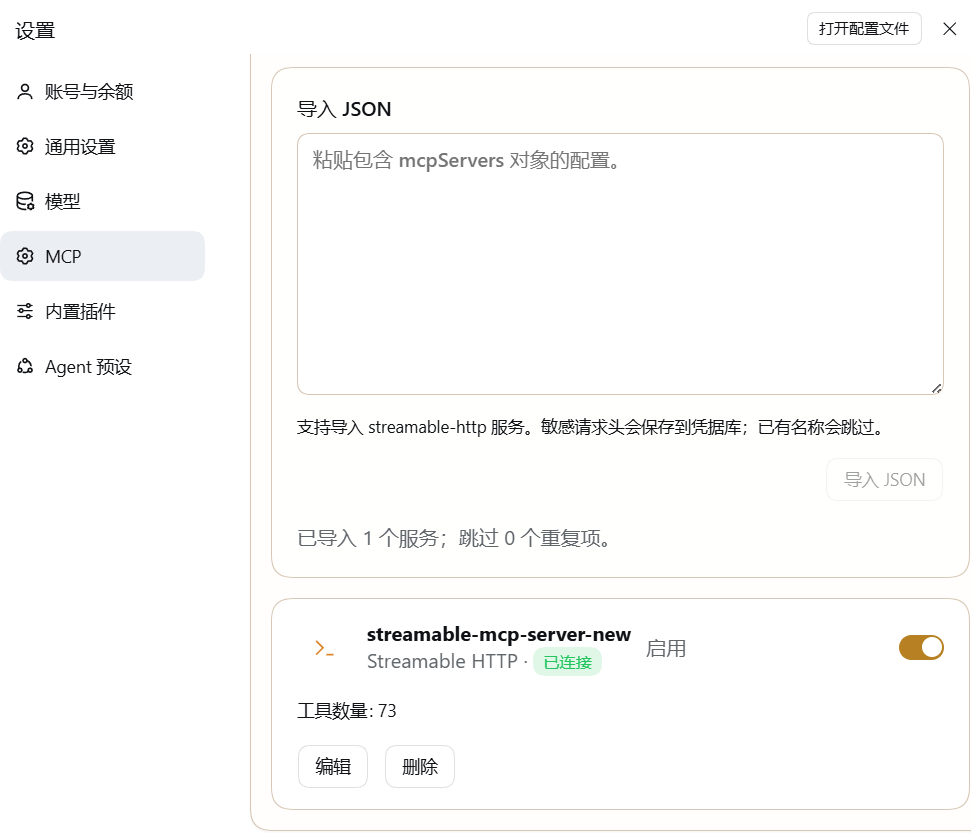

# `@tinyforge/dsh-mcp-settings`

English | [中文](README.zh.md)

An optional DSH bundle for configuring Streamable HTTP and stdio MCP servers from DSH Settings.



## Quick start

From the directory containing this checkout, adjust the local path if your checkout folder has a different name:

```sh
pnpm dsh plugin --profile <profile> add file:./dsh-mcp-settings
```

Then open **Settings → MCP Servers** to add a server or import a configuration.

## Features

- Configure Streamable HTTP and stdio MCP servers.
- Import Streamable HTTP entries from an `mcpServers` JSON object.
- Search and filter servers by name, connection state, and transport; inspect tool names and descriptions while connected.
- Preview JSON imports before saving, and reveal individual secret fields only when needed.
- Export managed settings as JSON. Credential values stay in the local credential store and must be configured separately in another profile.
- Store sensitive headers, including `Authorization`, in DSH's credential store.
- Check a server connection before saving its settings.
- Get fixed next-step guidance for authorization failures, connection failures, and timeouts.
- Keep `project-memory` servers separate from model-facing tools.

## Runtime behavior

The default server list is empty. Installing the bundle does not preconfigure or start an MCP service. Configured servers start when the profile loads. Only successfully connected servers with purpose `model-tools` publish tools to the model; `project-memory` servers remain with their registered consumer.

## Compatibility and implementation

This release requires DSH `0.2.2-alpha.2` or a later stable `0.2.x` release. The MCP client runtime is included under `vendor/`. The bundle disables the built-in MCP settings page, adds the managed server manager, and exports Host Typert metadata for connection checks. The base MCP client provides live connection status.

## Import limitation

JSON import accepts Streamable HTTP entries in an `mcpServers` object or managed server entries in a `servers` array. Add stdio servers from the settings form or import them in the managed format. Entries with duplicate names are skipped.
