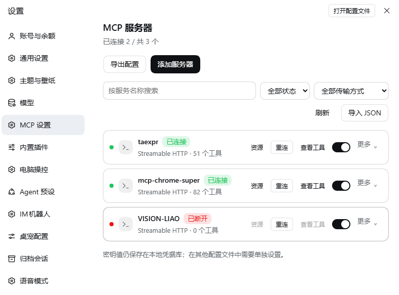
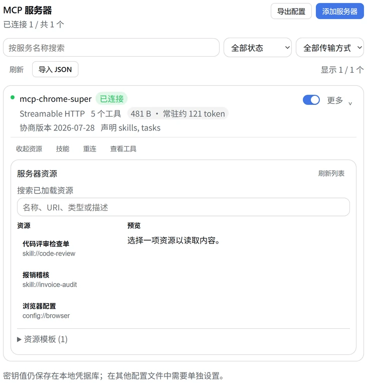
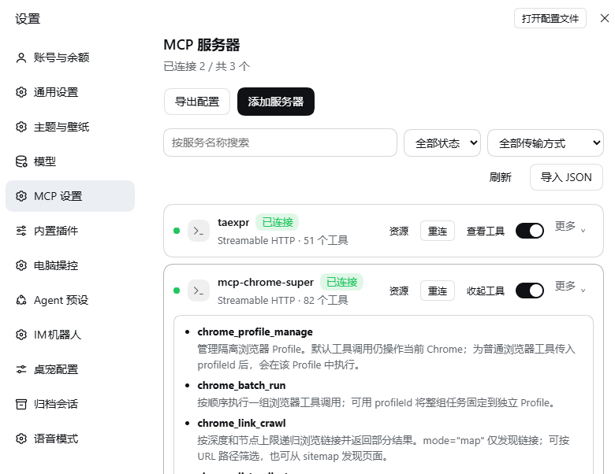

<p align="center"></p>

# `@tinyforge/dsh-mcp-settings`

[](LICENSE)
[](https://www.npmjs.com/package/@tinyforge/dsh-mcp-settings)
[](https://www.npmjs.com/package/@tinyforge/dsh-mcp-settings)
[](https://www.npmjs.com/package/@tinyforge/dsh-mcp-settings)
[](https://www.npmjs.com/package/@deepseek-ai/dsh)

English | [中文](README.zh.md)

An optional DSH bundle for configuring Streamable HTTP and stdio MCP servers from DSH Settings.





## Quick start

From the directory containing this checkout, adjust the local path if your checkout folder has a different name:

```sh
pnpm dsh plugin --profile <profile> add file:./dsh-mcp-settings
```

Then open **Settings → MCP Servers** to add a server or import a configuration.

## Features

- Configure Streamable HTTP and stdio MCP servers.
- Import Streamable HTTP entries from an `mcpServers` JSON object.
- Search and filter servers by name, connection state, and transport; inspect tool names and descriptions while connected.
- See each connected server's standing context cost on its card — definition bytes and a rough token estimate for the reported names and descriptions — before opening its tool list.
- Browse resource and resource-template metadata for connected `model-tools` servers, then explicitly read selected resources. Text is shown transiently; binary contents are omitted.
- See what each connection negotiated: the protocol revision on the card, plus the extensions a server declared — skills over MCP (`io.modelcontextprotocol/skills`) and tasks are reported as declared, never assumed.
- List a connected server's skills on demand: names and descriptions only, paged through the server's own cursor. A server that never declared the extension is not asked at all, and skill bodies are never read.
- Reconnect one enabled server from its settings card and see its resulting connection state.
- Preview JSON imports before saving, and reveal individual secret fields only when needed.
- Export managed settings as JSON. Credential values stay in the local credential store and must be configured separately in another profile.
- Store sensitive headers, including `Authorization`, in DSH's credential store.
- Check a server connection before saving its settings.
- Get fixed next-step guidance for authorization failures, connection failures, and timeouts.
- Keep `project-memory` servers separate from model-facing tools.

## Runtime behavior

The default server list is empty. Installing the bundle does not preconfigure or start an MCP service. Configured servers start when the profile loads. Only successfully connected servers with purpose `model-tools` publish tools to the model; `project-memory` servers remain with their registered consumer.

## Compatibility and implementation

This release requires DSH `0.2.2-alpha.2` or a later stable `0.2.x` release. The MCP client runtime is included under `vendor/`. The bundle disables the built-in MCP settings page, adds the managed server manager, and exports Host Typert metadata for connection checks, resource browsing, skill listings, negotiation facts, and per-server reconnects. Resource reads and skill pages are user initiated, limited to 512 KiB of serialized response data, and never persisted or passed into model context. The base MCP client provides live connection status, the negotiation summary, and the connection handle behind both lists.

## Auditing a server profile

Every MCP server publishes its tool definitions into model context before the first question is asked. `scripts/mcp-audit.mjs` measures that cost and the negotiation behind it, without calling a single tool:

```sh
node scripts/mcp-audit.mjs                                  # profile: ~/.dsh/profiles/web
node scripts/mcp-audit.mjs C:/Users/me/.dsh/profiles/web --json .audit/mcp-audit.json
```

The audit connects with the same SDK and automatic version negotiation the runtime uses, then reports per server:

- the negotiated protocol revision, the server identity it announced, its declared capabilities and extensions, and the size of its attributed instructions;
- every skill name the server lists when it declared the skills extension (names and descriptions only; bodies are never read);
- the standing cost of every tool definition (`name`, `description`, `inputSchema`, `outputSchema`) as UTF-8 bytes plus a `bytes / 4` token estimate, and the largest definitions by name;
- the model-facing names that the `mcp__<server>__<tool>` contract had to rewrite (character replacement, or truncation with a hash suffix);
- fixed check results for transport (`tls`, `loopback`, `private`, `plaintext-remote`), credential binding, naming, and context budget, plus resource and prompt counts when the server declares those capabilities.

Connection failures are classified as `failed`, `timed-out`, or `authorization-required`. Checks that depend on Host runtime policy, such as result truncation, are reported as `unverifiable` instead of being passed. No tool is called, no secret value is printed, and stdio rows are skipped unless you pass `--allow-stdio`. Use `--strict` to fail the run on warnings as well.

## Import limitation

JSON import accepts Streamable HTTP entries in an `mcpServers` object or managed server entries in a `servers` array. Add stdio servers from the settings form or import them in the managed format. Entries with duplicate names are skipped.
