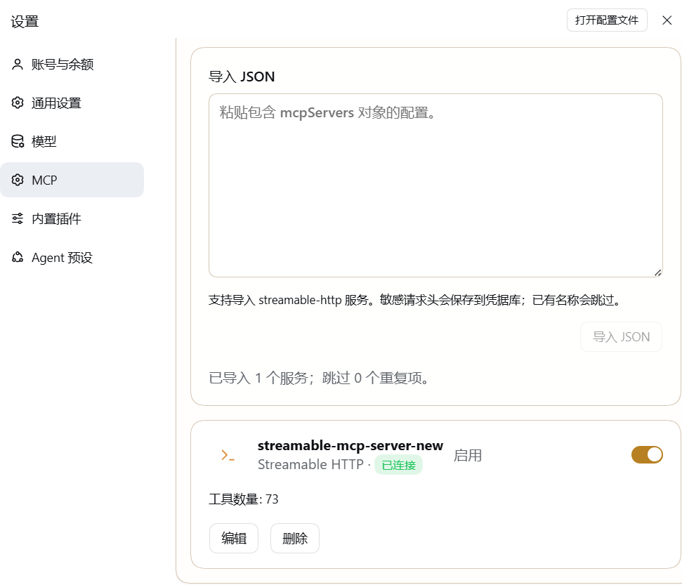

# `@deepseek-ai/dsh-mcp-settings`

[English](README.md) | 中文

一个可选的 DSH bundle，可在 DSH 设置中配置 Streamable HTTP 和 stdio MCP 服务。



## 快速开始

在本仓库所在目录运行以下命令，将 bundle 安装到指定 profile；如果仓库目录名不同，请相应调整本地路径：

```sh
pnpm dsh plugin --profile <profile> add file:./dsh-mcp-settings
```

然后打开 **设置 → MCP 服务器**，添加服务或导入配置。

## 功能

- 配置 Streamable HTTP 和 stdio MCP 服务。
- 从 `mcpServers` JSON 对象导入 Streamable HTTP 服务。
- `Authorization` 等敏感请求头会保存到 DSH credential store。
- 保存设置前可检查服务连接。
- `project-memory` 服务与模型可用工具分开管理。

## 运行方式

默认服务列表为空。安装 bundle 不会预配置或启动 MCP 服务；profile 加载后才会启动已配置的服务。只有用途为 `model-tools` 且连接成功的服务才会向模型提供工具；`project-memory` 服务仍由其注册的 consumer 管理。

## 兼容性与实现

此版本要求 DSH `0.2.2-alpha.2` 或后续稳定版 `0.2.x`。MCP client 运行时包含在 `vendor/` 中。bundle 会停用内置 MCP 设置页、添加托管服务管理器，并导出连接检查所需的 Host Typert 描述。实时连接状态由基础 MCP client 提供。

## 导入限制

JSON 导入支持 `mcpServers` 对象中的 Streamable HTTP 条目，以及 `servers` 数组中的托管服务条目。stdio 服务可从设置表单添加，或使用托管格式导入。重复名称会被跳过。
