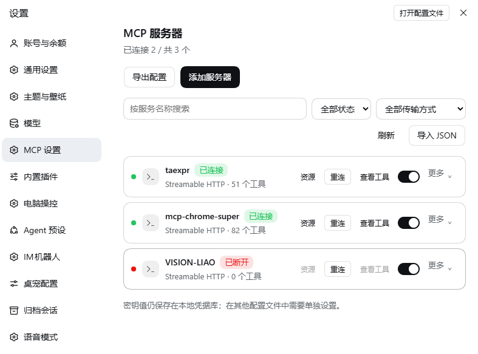
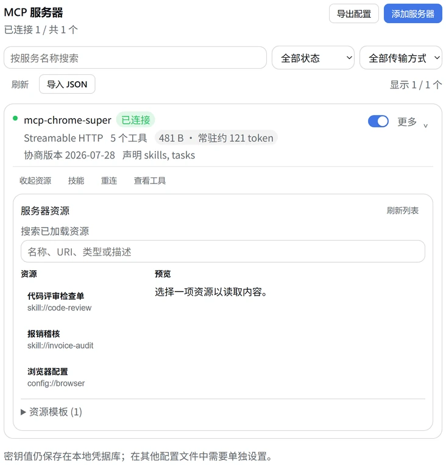
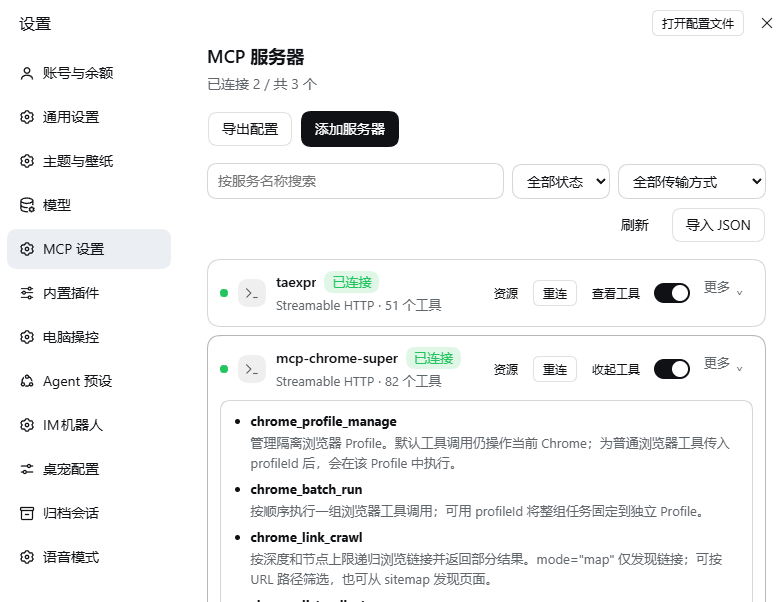

<p align="center"></p>

# `@tinyforge/dsh-mcp-settings`

[](LICENSE)
[](https://www.npmjs.com/package/@tinyforge/dsh-mcp-settings)
[](https://www.npmjs.com/package/@tinyforge/dsh-mcp-settings)
[](https://www.npmjs.com/package/@tinyforge/dsh-mcp-settings)
[](https://www.npmjs.com/package/@deepseek-ai/dsh)

[English](README.md) | 中文

一个可选的 DSH bundle，可在 DSH 设置中配置 Streamable HTTP 和 stdio MCP 服务。





## 快速开始

在本仓库所在目录运行以下命令，将 bundle 安装到指定 profile；如果仓库目录名不同，请相应调整本地路径：

```sh
pnpm dsh plugin --profile <profile> add file:./dsh-mcp-settings
```

然后打开 **设置 → MCP 服务器**，添加服务或导入配置。

## 功能

- 配置 Streamable HTTP 和 stdio MCP 服务。
- 从 `mcpServers` JSON 对象导入 Streamable HTTP 服务。
- 按名称、连接状态和传输方式搜索筛选服务；连接成功时可查看工具名称和描述。
- 无需展开工具清单，服务卡片即显示该服务的常驻上下文成本——按已上报的名称与描述统计的字节数，以及粗估 token。
- 浏览已连接 `model-tools` 服务的资源及资源模板元数据，并按需读取选中的资源。文本仅临时显示，二进制内容不会传回页面。
- 显示每条连接协商到了什么：卡片上给出协议修订版，以及服务端声明的扩展——Skills over MCP（`io.modelcontextprotocol/skills`）与 Tasks 一律按“已声明”呈现，不做假定。
- 按需列出已连接服务的技能：只取名称与描述，按服务端自己的游标分页。未声明该扩展的服务根本不会被请求，技能正文也不会被读取。
- 在服务器卡片中单独重连某个已启用服务，并查看重连后的连接状态。
- 导入前预览 JSON；需要时可单独显示某个密钥输入框。
- 将托管配置导出为 JSON。密钥值保存在本地凭据库中，需要在其他配置文件中单独设置。
- `Authorization` 等敏感请求头会保存到 DSH credential store。
- 保存设置前可检查服务连接。
- 授权失败、连接失败和超时时会显示固定的排查建议。
- `project-memory` 服务与模型可用工具分开管理。

## 运行方式

默认服务列表为空。安装 bundle 不会预配置或启动 MCP 服务；profile 加载后才会启动已配置的服务。只有用途为 `model-tools` 且连接成功的服务才会向模型提供工具；`project-memory` 服务仍由其注册的 consumer 管理。

## 兼容性与实现

此版本要求 DSH `0.2.2-alpha.2` 或后续稳定版 `0.2.x`。MCP client 运行时包含在 `vendor/` 中。bundle 会停用内置 MCP 设置页、添加托管服务管理器，并导出连接检查、资源浏览、技能列表、协商信息与单服务重连所需的 Host Typert 描述。资源读取与技能分页由用户主动触发，序列化响应限制为 512 KiB，不会持久化，也不会进入模型上下文。实时连接状态、协商摘要以及两份列表背后的连接句柄由基础 MCP client 提供。

## 接入体检

每个 MCP 服务在提问之前就把工具定义注入了模型上下文。`scripts/mcp-audit.mjs` 在不调用任何工具的前提下，量出这份成本与它背后的协商结果：

```sh
node scripts/mcp-audit.mjs                                  # profile: ~/.dsh/profiles/web
node scripts/mcp-audit.mjs C:/Users/me/.dsh/profiles/web --json .audit/mcp-audit.json
```

体检使用与运行时相同的 SDK 与自动版本协商建立连接，逐服务报告：

- 协商到的协议修订版、服务端自报身份、已声明能力与扩展，以及归属 instructions 的字节数；
- 服务声明了技能扩展时，列出它返回的每个技能名称（只取名称与描述，不读正文）；
- 每个工具定义（`name`、`description`、`inputSchema`、`outputSchema`）以 UTF-8 字节计的常驻成本、`字节 / 4` 的粗估 token，以及占用最大的几个定义；
- 被 `mcp__<server>__<tool>` 契约改写过的模型侧名称（字符被替换，或截断后加哈希）；
- 传输方式（`tls`、`loopback`、`private`、`plaintext-remote`）、凭据绑定、命名与上下文预算的固定检查结果；服务声明了对应能力时，另附资源与提示的条目数。

连接失败会归类为 `failed`、`timed-out` 或 `authorization-required`。依赖 Host 运行时策略的检查（如结果截断）标为 `unverifiable`，不冒充通过。体检不调用工具、不打印任何秘密值；stdio 行默认跳过，需显式传 `--allow-stdio`。加 `--strict` 时出现告警即判定失败。

## 导入限制

JSON 导入支持 `mcpServers` 对象中的 Streamable HTTP 条目，以及 `servers` 数组中的托管服务条目。stdio 服务可从设置表单添加，或使用托管格式导入。重复名称会被跳过。
